# Digital Portfolio – Jagruti Badgujar

**Live site: https://jagruti731.github.io/cs5709-digital-portfolio/** · Repository: https://github.com/Jagruti731/cs5709-digital-portfolio

CS5709 Software Engineering Evolution, University of Limerick (2026–27). Student ID 26352893.
Version 2.0 is Phase 2 (Assessment 3). It continues Phase 1, which evolved the lecturer's starter
portfolio ([saaysalim/Salim-Saay](https://github.com/saaysalim/Salim-Saay)) in place, so the whole history,
from the starter to this version, is in this repository.

This file is the single source of documentation. GitHub shows it on the repository page, and the site
shows the same file on its **Readme** page (`src/pages/Readme.tsx` imports it), so the two cannot drift apart.

## 1. Overview

| Item | Detail |
| --- | --- |
| What | A personal portfolio: Home, About (with education), Professional Knowledge (Work), Gallery (pictures), Blog with a community feed, Contact (instant messaging), plus Readme, Dashboard and Search |
| Stack | React 18, TypeScript (strict), Vite 6, React Router 6 (HashRouter), Redux Toolkit, plain CSS |
| Phase 1 (v1.0) | Starter analysed and evolved: 10 typed change requests, CR-01 to CR-10 |
| Phase 2 (v2.0) | Peer review and lecturer feedback applied, JSON content, CI/CD, live on GitHub Pages, innovation features |

| Tag | Meaning |
| --- | --- |
| `v0-starter` | The starter exactly as downloaded |
| `v1.0` | End of Phase 1 (Assessment 1) |
| `v2.0` | End of Phase 2 (Assessment 3) |

```bash
git log --oneline v1.0..v2.0     # every Phase 2 change, one commit each
```

## 2. Quick start

Requires Node.js 22 or later.

```bash
npm ci               # install exactly the versions in package-lock.json
npm run dev          # http://localhost:3000
npm run build        # strict type check, then the static site in build/
npm run preview      # serve build/ on http://localhost:4173
```

| Script | What it does |
| --- | --- |
| `npm run lint` | ESLint with TypeScript and React hooks rules, zero warnings allowed |
| `npm run format:check` | Prettier: fails if any file is not formatted |
| `npm run typecheck` | `tsc --noEmit` in strict mode |
| `npm test` | Vitest unit and component tests |
| `npm run test:coverage` | the same, with a coverage report and minimum thresholds |
| `npm run test:api` | API server tests against a temporary data folder |
| `npm run test:e2e` | Playwright walkthrough of the built site |
| `npm run ci` | everything the pipeline checks, in the same order |

Optional API server for a shared community feed:

```bash
cd server && npm ci && npm start                       # http://localhost:5000
VITE_API_URL=http://localhost:5000 npm run dev
```

## 3. Project structure

```text
├── .github/workflows/        CI/CD pipeline
├── docs/diagrams/            Mermaid sources of every diagram (rendered to public/diagrams)
├── public/
│   ├── data/                 JSON content files (dynamic data, loaded at run time)
│   ├── diagrams/             rendered diagrams (SVG)
│   └── images/               media
├── server/                   optional Express API (posts, comments, likes, accounts)
├── firestore.rules           security rules of the shared feed and lounge (Firebase)
├── src/
│   ├── main.tsx · App.tsx    entry point and router
│   ├── routes.tsx            page list joined with page components
│   ├── config/site.ts        site constants and limits (no magic numbers in components)
│   ├── config/firebase.ts    Firebase project settings (public) and collection names
│   ├── types/content.ts      typed contracts for every JSON file
│   ├── services/             the only code that talks to the network or storage (cloud.ts: Firebase)
│   ├── store/                Redux slices: content, posts, auth, github
│   ├── hooks/                useContent, useStoredState, typed Redux hooks
│   ├── features/             feature folders: logic in a hook, display in components
│   │   ├── feed/             usePostFeed · PostForm · PostCard · SignInForm
│   │   ├── chat/             useChat · answers · Chat
│   │   ├── docs/             README renderer · Requirements · ChangeLog
│   │   ├── search/           search engine · documents · useSearch
│   │   ├── github/           live GitHub panel
│   │   ├── quality/          code quality dashboard
│   │   ├── motion/           GSAP hooks
│   │   ├── media/            picture gallery
│   │   ├── projects/         case-study filter
│   │   └── pwa/              install, offline and update notices
│   ├── components/           shared UI: Layout, Navbar, Section, Card, LoadState …
│   ├── pages/                one file per route
│   └── styles/global.css     the only stylesheet
└── tools/                    API, rules and browser tests, quality report, code index, diagram renderer
```


**Site scheme.** Six menu items share one navigation bar (seven before CR-33, when Education became a section of About); Readme and Dashboard are linked from the
footer; Search sits outside the menu and is
opened with the Search button or the `/` key; unknown addresses show Not found.

Every source file starts with an `@file` JSDoc comment that says what the file does and where its data
comes from, and exported functions have JSDoc comments.

## 4. Architecture



**Figure 1. Block diagram.** Content and code are checked and built by GitHub Actions and published to
GitHub Pages. In the browser, the router loads each page on demand, pages read content through the Redux
store, and the store fetches JSON files from the site and live data from the GitHub API.



**Figure 2. Component (module) view.** Dependencies only point downwards: pages use features and shared
components; features use the store; only `services/` talks to the network.

### 4.1 Why each folder is its own part (partitioning)

| Part | Responsibility | May depend on |
| --- | --- | --- |
| `pages/` | Lay out one route | components, features, hooks, lib, config, types |
| `features/` | One user-facing feature: logic in a `use…` hook, display in components | components, hooks, store, services, lib, config, types |
| `components/` | Shared presentation; the Layout shell starts the motion and app-status features | features, hooks, lib, config, types |
| `hooks/` | Connect React to the store | store, lib, types |
| `store/` | Shared state and its transitions | services, types |
| `services/` | Network and storage, nothing else | lib, config, types |
| `lib/` | Small pure helpers | config, types |
| `config/`, `types/` | Constants and contracts | nothing |

These rules are not only written down: the pipeline checks them on every push (section 12.4,
architecture conformance), so a forbidden import shows up on the Dashboard.

The rule "dependencies point downwards" keeps a change local: for example, moving the feed to a hosted
API changes `services/postsApi.ts` and `features/feed/usePostFeed.ts` only.

### 4.2 Loading content (control flow)



**Figure 3. Control flow of `useContent`.** A content file is fetched once, checked against its shape
rule, and cached in the store. Every failure has a readable reason and a *Try again* button.

## 5. Requirements

Phase 1 took its requirements from the brief. Phase 2 starts from three personas, each with a scenario
(Cooper, 2004; Carroll, 2000), eleven user stories, and a feature list in which every feature is traced to
the stories it serves. They live in `public/data/requirements.json` and are shown, with a phase filter,
on the Readme page under **Requirements**.

| Persona | Scenario in one line |
| --- | --- |
| P1 Aoife, hiring manager in Dublin | Two minutes between interviews: projects first, filter by .NET, check GitHub activity |
| P2 Dr Saay, module assessor | Checks every brief item, follows the review table to commits, checks the pipeline is green |
| P3 Rahul, fellow MSc student | Reads a post, asks the assistant, comments, re-reads offline on the bus |

A unit test fails if a story points to a persona or feature that does not exist.

## 6. Dynamic data with JSON files

All page content is in `public/data/*.json`, separate from the code. Editing text never touches a
component, and the files are fetched at run time, cached in the Redux store, and validated before use.

| File | Used by |
| --- | --- |
| `profile.json` | Home, About |
| `projects.json` | Home, Professional Knowledge, Search |
| `career.json` | Home, About |
| `education.json` | About (Education section) |
| `gallery.json` | Gallery → Pictures |
| `blog.json` | Blog |
| `requirements.json` | Readme → Requirements |
| `changelog.json` | Readme → Change log |

## 7. State management

Redux Toolkit holds state that more than one component needs:

| Slice | Holds |
| --- | --- |
| `content` | each JSON file with its status: idle, loading, ready or error |
| `posts` | community feed posts, comments and likes |
| `auth` | the user signed in to the optional API |
| `github` | live data from the GitHub API, with its loading status |

State that belongs to one component (a form draft, an open picture) stays in `useState`, and state that
must survive a reload (theme, chat history, local posts) is saved with `useStoredState`.

## 8. Testing

| Level | Tool | What is checked |
| --- | --- | --- |
| Unit | Vitest | reducers; every real JSON file against its shape rule; search engine (tokens, BM25, typos, highlighting); case-study filter; GitHub service with a fake `fetch`; chat answers and limits; README renderer |
| Component | Vitest + Testing Library (jsdom) | PostCard, LoadState, Requirements and Change log tabs, both Dashboard tabs; the shared feed and lounge with a fake cloud service |
| API | bash + curl (`tools/api-test.sh`) | 16 checks: accounts, ownership, comment author from the token, body limit, corrupt-file safety |
| Security rules | Firestore emulator + `@firebase/rules-unit-testing` (`tools/rules-test.mjs`) | 28 checks of what a visitor may and may not read or write: posting in someone else's name, fake times, unknown fields, liking for someone else, editing comments, deleting other people's posts |
| Browser | Playwright (`tools/browser-test.mjs`) | 15 walkthrough checks: every route, skip link, gallery, feed, chat, Readme tabs, smart search, Dashboard, dark mode, mobile width, the offline app, no console errors |

All five levels run in the pipeline; the Dashboard shows the latest results (section 12.4).

### 8.1 Inspection of the Phase 2 code

Before release, I inspected my own Phase 2 code the same way I inspected my peer's (Fagan, 1976;
lecture 6): entry criteria first (it builds, lint passes, all tests pass), then every changed file read
line by line against the lecture's checklist of error types, with each finding logged. The
architecture conformance check (section 12.4) found two more.

| ID | File | Checklist category | Defect | Fix |
| --- | --- | --- | --- | --- |
| D1 | `features/search/searchIndex.ts` | Comparison | `highlight()` tested matches with a *global* RegExp and reset `lastIndex` inside an expression: fragile and hard to read | separate non-global pattern; regression test |
| D2 | `features/feed/usePostFeed.ts` | Computation | size message rounded to whole MB, so a 500 KB limit printed "1 MB" | `formatBytes()`; test |
| D3 | `features/chat/useChat.ts` | Control flow | assistant reply timers kept running after the chat closed | timers kept in a ref and cleared on unmount |
| D4 | `components/Layout.tsx` | Data reference | `/` shortcut called `closest()` on the event target, which can be the document | `instanceof Element` guard |
| D5 | `services/githubApi.ts` | Interface | on a GitHub error the saved copy was shown with no sign it was old | `stale` flag, shown on the page |
| D6 | `features/feed/PostForm.tsx` | I/O | the file input was not cleared after posting, so the same picture could not be chosen again | input reset with a key |
| D7 | `config/site.ts` | Data declaration | version typed in two places (`package.json` and `site.ts`) | injected from `package.json` at build time |
| D8 | `styles/global.css` | I/O | blocks waiting for their scroll animation printed blank | print rule shows everything |
| D9 | `pages/Search.tsx` | Interface | `autoFocus` moved focus (and opened the phone keyboard) on every visit | focus only when opened with `/` |
| A1 | `services/postsApi.ts` | Architecture | service imported types from the Redux store (divergence) | types moved to `types/posts.ts` |
| A2 | `components/LoadState.tsx` | Architecture | shared component imported a type from the store (divergence) | `LoadStatus` moved to `types/content.ts` |

Exit criteria: every finding fixed, all checks green, and no divergence left in the reflexion model.

## 9. CI/CD pipeline

`.github/workflows/ci-cd.yml` runs on every push to `main`, on every pull request to `main` (including
Dependabot's), and by hand (*Run workflow*). It has five jobs:


**Figure 4. The pipeline.** `quality`, `api` and `rules` run in parallel; `build` starts only if all three pass;
`deploy` runs only for a push to `main`.

| Job | Steps | Fails when |
| --- | --- | --- |
| `quality` | `npm ci`, ESLint, Prettier, `tsc`, Vitest with coverage; reports kept as an artifact | any lint warning, unformatted file, type error, failing test, or coverage below 60% |
| `api` | `npm ci` in `server/`, `tools/api-test.sh` | any of the 16 API checks returns the wrong status |
| `rules` | Java 21, the Firestore emulator (cached), `tools/rules-test.mjs` | any security rules check is allowed when it should be refused, or the other way round |
| `build` | `vite build`, Playwright walkthrough of the built site, the quality report (`quality.json`, section 12.4), upload of `build/` as the Pages artifact | the build fails, or any walkthrough step fails |
| `deploy` | `actions/deploy-pages` to the `github-pages` environment | (only runs after `build` passes on `main`) |

Design decisions:

- **Fail fast, deploy once.** Cheap checks run first and in parallel; the site is built once, tested,
  and that exact artifact is deployed. Nothing reaches the live site without passing every check.
- **Least privilege.** The workflow token can only read the repository; only `deploy` gets
  `pages: write` and `id-token: write`.
- **Reproducible.** `npm ci` installs exactly the versions in `package-lock.json`; Node 22 everywhere.
- **No wasted runs.** A newer push cancels the older run on the same branch, but a deployment that
  has started is never cancelled.
- **Kept evidence.** Test, coverage, browser and quality reports are uploaded as artifacts for 14 days, and
  the build job collects the unit and API results from the earlier jobs for the quality report.
- **Dependencies stay current, safely.** Dependabot (`.github/dependabot.yml`) opens grouped weekly pull
  requests for patch and minor updates, and each one has to pass the same pipeline before it can be
  merged. On the first push it proposed a group of 14 tool updates that included ESLint 10; the
  pipeline stopped it at the lint step, so it never reached `main`. Major versions are left out and
  planned by hand.

Run the same checks locally before pushing: `npm run ci`.

## 10. Deployment (GitHub Pages)

The site is static, so GitHub Pages serves it directly; there is no server to run.

1. One-time setup: repository **Settings → Pages → Build and deployment → Source: GitHub Actions**.
2. Push to `main`. The `deploy` job publishes the tested `build/` folder.
3. The URL appears on the run summary and under **Environments → github-pages**.

Two choices make the same build work under the repository sub-folder (`/cs5709-digital-portfolio/`):
Vite builds with relative paths (`base: './'`), and `HashRouter` keeps every route inside `index.html`
(`/#/about`), so a refresh on any page never returns a 404.

## 11. Interactivity and performance

### 11.1 GSAP animations

GSAP (with its ScrollTrigger and Flip plugins) adds movement that explains rather than decorates.
All of it lives in `src/features/motion/`:

| Hook | Where | What it does |
| --- | --- | --- |
| `useScrollReveal` | every page (Layout) | cards, case studies and pictures fade up as they scroll into view; a MutationObserver picks up content that loads later |
| `useFlip` | Professional Knowledge, Gallery | when a filter changes, the remaining cards glide to their new places and new ones fade in |

Rules every animation follows:

- **Reduced motion is respected.** If the visitor's system asks for less motion, GSAP is never even
  downloaded and everything appears at once (WCAG 2.2, success criterion 2.3.3).
- **Nothing visible flickers.** Only blocks below the fold are hidden before they animate.
- **GSAP is lazy-loaded.** It is imported dynamically, so its 70 kB arrive after the page is usable.
- **One rhythm.** Durations, distances and easing come from one `MOTION` constant.

### 11.2 Search and filters

| Page | Filter |
| --- | --- |
| Professional Knowledge | case studies by technology and by free text (user story US2), animated with Flip |
| Gallery → Pictures | by category (places, work, life), animated with Flip |
| Blog | articles by tag |
| Readme → Requirements | features by phase |
| Readme → Change log | changes by phase and maintenance type |
| Search | the whole site, see section 12 |

### 11.3 Lazy loading

- **Pages:** every page is a `React.lazy` chunk downloaded on its first visit, inside `Suspense`
  (skeleton while loading) and an error boundary (reload button if a chunk cannot be fetched).
  The main bundle fell from 257 kB to 206 kB.
- **Libraries:** GSAP and the Markdown renderer load only on the pages that use them.
- **Media:** images use `loading="lazy"` and `decoding="async"`.
- **Data:** each JSON file is fetched only when a page first needs it.

### 11.4 A leaner site (CR-30)

After the release I compared the site with my LinkedIn profile, and it felt too heavy: long
paragraphs, eleven menu items and animation on every page. CR-30 made it leaner without removing any
required page:

| Before | After |
| --- | --- |
| 11 menu items | 7: Home, About, Education, Work, Gallery, Blog, Contact; Readme and Dashboard in the footer |
| Pictures and Videos as two pages | one Gallery page with two tabs; `/videos` redirects |
| Home: intro, numbers, 3 projects, career path, 6 extras | intro, numbers and 3 projects |
| Blog articles shown in full | first paragraph, with *Read more* |
| Content written for Phase 1 | rewritten from my LinkedIn profile: current role (Consultant), dates, NIT Warangal diploma, awards |
| Page entrance, count-up and reveal animations | scroll reveal on cards only |

### 11.5 From a basic portfolio to an engineer's portfolio (CR-33)

The leaner site still looked like a standard template: a dark banner, plain cards and grey. CR-33 is
one perfective change with two parts.

**Fewer, stronger sections.** Nothing the brief or the reviews ask for was removed; repeated content was.

| Before | After |
| --- | --- |
| 7 menu items, Education as its own page | 6: Education is a section of About (`/education` redirects there, and search results link to it) |
| Work: case studies, then *Other projects* and *Skills* lists | case studies only; every case study already lists its tools, so the lists repeated them |
| About: story, *What I do* boxes, experience, recognition | story, experience, education, certifications, recognition |
| Contact: chat and a table of contact facts | one LinkedIn button above the chat |

**A look that shows engineering.** The hero now shows a live *system status* panel next to my name. It
reads `quality.json`, which the pipeline writes for the exact commit that is live, and shows the
checks passing, coverage, architecture rule breaks and whether the shared feed is connected, with
links to the quality report, the pipeline run and this README. The rest is visual only and lives in
one section of `global.css` (later replaced): ink surfaces with a faint engineering grid, Space Grotesk headings,
JetBrains Mono for labels and numbers, one signal colour, numbered section kickers, a timeline rail and
hover lift on project cards. Both fonts are self-hosted, so the installed offline app looks the same
with no network. Every test passed after the change, and the status logic (`statusRows`) has its own
unit tests.

### 11.6 Showing what I really do (CR-34)

After CR-33 the site looked right but said too little: four case studies with three bullets each,
while my work covers engineering, team leadership, presales and AI adoption. CR-34 adds content, not
features, and follows one rule: **no client names anywhere**, because naming a client in public
material would breach confidentiality. Client and bank names were removed from the pages, the blog and
the pipeline diagram, and the case studies describe clients only by their sector.

| Before | After |
| --- | --- |
| No photo | my LinkedIn photo on Home and About |
| About: story, experience, education | adds *How I work*: engineering, leadership and presales, AI adoption and teaching, each with evidence |
| 4 case studies, problem + what I did | 7 case studies, each with **my role** and, where I have them, **real results** (team of 15; about 1,000 documents processed) |
| Gallery: places, diagrams, two stock-style photos | adds *Talks & awards*: Guest of Honour at Genesis 2K26, a Git session I taught, Town Hall recognition, Winspire awards, my CK metrics research poster |
| 3 blog articles | 5: two new ones written from my LinkedIn posts on AI-generated code quality and tech leadership |

Only numbers I can state are shown; case studies without measured results have no results line.

### 11.7 A design that is mine: "Nashik to Limerick" (CR-36)

The dark engineering theme of CR-33 still looked like many developer sites. CR-36 gives the site an
idea of its own: the flags of India and Ireland share saffron, white and green, and my story runs
from Nashik to Limerick. So the site uses warm paper, ink text and only those two colours; Fraunces (a
soft serif) for headings, Inter for text and JetBrains Mono for small labels; a route line from Nashik
to Limerick above my name; my photo in an arch; and a three-colour bar on banners, cards and the footer.
The live pipeline status from CR-33 stays, as a slim ink band under the hero. The gallery keeps only
real photos (the four drawings and four diagrams were removed; the diagrams stay on Work), and the
videos have new thumbnails. All of it was one section of `global.css` (removed in CR-42), so no component logic changed.

CR-37 adds motion in the style of motion-graphics prompts (removed in CR-42): the name rises
line by line, the Nashik to Limerick route draws itself, the photo arch opens from the bottom, banner
bars sweep in and the status dots pulse. It is CSS only (no new JavaScript), runs once, and is switched
off completely when the visitor's system asks for reduced motion (WCAG 2.2, 2.3.3).

CR-40 is a complete redesign, after the owner said she did not like the vibe and wanted everything aligned
with the assignments. The portfolio is a software-evolution project, so it now looks like one: a dark
"evolution log" (removed in CR-42) with a lime accent, mono labels and the four maintenance types
(corrective, adaptive, perfective, preventive) as the only other colours. Home tells the story of the three
assignments (A1 lecturer feedback, A2 peer review, A3 this site), draws a git log of the versions, and shows
the change requests by maintenance type with the newest commits, all read from `changelog.json`
(`features/evolution`). The motion is in the style of motion-graphics prompts: two kinetic type lines, an
underline that draws, a log that writes itself and bars that fill. It is CSS only and is off for reduced motion.

CR-41 replaced that with a "clean corporate" look (removed in CR-42), because the owner wanted a
professional site ready to submit: white page, navy text, one blue accent, Inter only and soft cards. Home now
speaks to employers and clients (intro, photo card, key numbers, selected work, how I build software, a contact
band); the assignment material (lecturer feedback, peer review, iterations, change log) stays on this Readme
page, linked from the footer, so the marker still finds it.

CR-42 is the final look, which the owner chose from three real mockups (editorial, bento grid, dark
aurora) after saying the site still felt basic and traditional. It was "editorial" (replaced in CR-43):
a white page, near-black ink, very large Instrument Serif headlines with orange italic emphasis, Inter for
text, thin rules instead of boxes, and the selected work as a numbered index whose rows fill on hover. The
diagram pictures of the case studies were replaced by typographic covers (`components/CaseCover.tsx`) and
deleted, and the video posters were redrawn in the same style. The four older theme layers (about 1,900
lines of CSS that the newest layer overrode) and the unused Fraunces font were deleted as preventive
maintenance, so there is one theme layer on top of the base styles. The motion follows motion-graphics
prompts: headline lines slide up out of a mask, the photo arch opens, a skills ticker runs (paused on
hover), the maintenance bars draw, and work rows fill on hover. It is CSS only and off for reduced motion.

CR-43 is the final design. After researching award-winning portfolios, the owner chose a custom idea
from a live prototype: the site reads like a scanner, because Document AI is her real work. The Home hero
reads her profile like a scanned document (a beam sweeps the card, boxes snap round each field with a
confidence score, the JSON appears and an EXTRACTED stamp lands). A section shows readiness for agentic AI
work in three pillars, each with a line of proof. All eight systems (the seven case studies and this site)
are shown as live automated runs: a document moves through the steps, agent and human steps are labelled,
and a run log writes as it goes (`features/showcase`). The tech stack (CR-46) is shown as four AI-era layers with a
core / growing / learning-now level per technology and a filter by 2026 trend (`TechStack.tsx`, `stackFilter.ts`). Home text lives in
`showcase.json`, checked like every other content file. Motion uses GSAP (already a dependency) and Lenis
for smooth scrolling, plus magnetic buttons and a scanner cursor; all of it is off for reduced motion and
the cursor only appears for a mouse. Section 9 of `global.css` is the only theme layer.

CR-47 made the site read as a personal portfolio: the videos were removed from the Gallery (the old `/videos`
address opens the gallery), and the footer no longer shows the module name or the Readme link. This
Readme page is still part of the site for anyone given its address.

CR-50 measured the result. Lighthouse (default mobile settings, median of three runs, `tools/lighthouse-compare.sh`,
results in `tools/lighthouse-v1-v2.json`):

| Page | Version | Performance | Accessibility | Best practices | SEO | LCP | TBT |
| --- | --- | --- | --- | --- | --- | --- | --- |
| Home | v1.0 | 92 | 100 | 100 | 100 | 3.0 s | 19 ms |
| Home | v2.0 | 81 | 100 | 100 | 100 | 4.0 s | 139 ms |
| Work | v1.0 | 90 | 96 | 100 | 100 | 3.3 s | 15 ms |
| Work | v2.0 | 80 | 100 | 100 | 100 | 4.3 s | 81 ms |

The richer Phase 2 site first scored 57 on Home; loading animation code after the page, a CSS ticker,
no per-frame repaint, Home in the main bundle, preloaded content and skipped offscreen sections raised it
to 81. The remaining gap is the cost of the motion and the larger feature set. The pipeline also runs
axe-core WCAG 2.2 AA checks on nine pages in light and dark (`tools/browser-test.mjs`, check 14).

## 12. Innovation

Four features go beyond a static GitHub Pages portfolio and beyond what was covered in class.

### 12.1 Smart search and concept location in the code

`src/features/search/searchIndex.ts` is a small search engine written for this site (no library), so
every step can be read and tested:

1. **Tokenise:** lower case, split `camelCase`, keep `.NET` and `C#`, drop stop words.
2. **Inverted index:** each term points to the documents and fields it appears in.
3. **Rank with BM25** (Robertson & Zaragoza, 2009), with field weights title 3, tags 2, body 1.
4. **Expand each query word:** prefix matches (search as you type) and near misses within one or two
   edits (Levenshtein distance), each scored lower than an exact match. When a word was only found as a
   near miss, the page says *Showing results for …* (try `Gemni bank`).
5. **Highlight** the matched terms in each result.

Two collections can be searched:

- **This site:** pages, case studies, articles, qualifications, jobs and pictures.
  Results can be filtered by type, and the query is kept in the URL, so a search can be shared.
- **Source code:** *concept location*, a core software-evolution task (Rajlich & Wilde, 2002): given a
  concept, find the code that implements it. `tools/build-code-index.mjs` indexes every source file
  (its `@file` header, exported names and comments) at build time; the same BM25 engine ranks the files
  (an information-retrieval approach to concept location, as in Marcus et al., 2004). Searching `skip link` returns
  `src/components/Layout.tsx` first, and each result opens the file on GitHub. This only works because
  Phase 2 gave every file a descriptive header comment.

Press `/` anywhere on the site to open Search.

### 12.2 Live GitHub data

The **Dashboard** page (tab *GitHub (live)*) calls the GitHub REST API from the visitor's browser on
every visit (`src/services/githubApi.ts`, state in `store/githubSlice.ts`):

| Shown | API endpoint |
| --- | --- |
| account summary and languages | `GET /users/Jagruti731`, `GET /users/Jagruti731/repos` |
| the latest 10 runs of this site's CI/CD pipeline, passed or failed | `GET /repos/Jagruti731/cs5709-digital-portfolio/actions/workflows/ci-cd.yml/runs` |
| the latest commits to this site | `GET /repos/Jagruti731/cs5709-digital-portfolio/commits` |

- **Rate limit:** GitHub allows 60 requests an hour without a token. Every answer is cached with its
  ETag; the next request sends `If-None-Match`, and an unchanged answer (`304`) does not count.
  The page shows how many requests are left.
- **Failure:** offline, the last copy is shown; at the limit, the page says when to try again; a
  repository with no runs yet says so instead of failing.
- **Interaction:** repositories can be filtered by language and sorted; *Refresh* reloads everything.
- **Testing:** unit tests replace `fetch`; the browser test answers GitHub requests itself, so CI never
  depends on GitHub's limit.

This replaces the starter's parked `legacy/phase2-candidates/GitHubIntegration.tsx`, which was deleted.

### 12.3 Installable offline app (Progressive Web App)

The site can be installed on a phone or laptop like an app, and it works with no connection
(user story US10: re-reading a post on the bus). Built with `vite-plugin-pwa`, which generates a
Workbox service worker at build time (`vite.config.ts`):

| Part | Behaviour |
| --- | --- |
| Web app manifest | name, icons (including a maskable icon), theme colour, standalone display, shortcuts to Search, Knowledge and Blog |
| Precache | HTML, every JavaScript chunk, CSS, fonts, icons and all JSON content (64 files, about 1 MB) are cached when the service worker installs, so every page opens offline, even one never visited |
| Runtime cache | pictures and diagrams: cache first, kept 30 days; content JSON: network first with a 4-second timeout |
| Install button | the browser's install prompt is caught and offered as our own *Install* notice |
| Updates | after a new deployment the visitor sees *A new version is ready – Reload*; nothing reloads by surprise |
| Offline notice | a banner says the site is offline and that live GitHub data needs a connection |

The browser test switches the network off, reloads, and checks that the About page still renders
from the cache.

### 12.4 Code quality dashboard and architecture conformance

The **Dashboard → Code quality** tab shows a report that the pipeline writes for the exact commit that
is live (`tools/quality-report.mjs` → `quality.json`, deployed with the site). Nothing on it is typed by
hand:

| Measure | Source |
| --- | --- |
| Tests passed: unit and component, API, browser | Vitest JSON report, `api-results.json`, `e2e-results.json` |
| Coverage of the logic layer (lines, statements, functions, branches) | Vitest v8 coverage summary, with the 60% threshold drawn on the bar |
| Lint errors and warnings | ESLint, run through its Node API |
| Cyclomatic complexity of every function, in four bands, and the most complex ones | ESLint's `complexity` rule set to 0, so it reports every function |
| Share of source files with an `@file` header | the source files themselves |
| Size of every JavaScript chunk, raw and gzip | `build/assets` |
| Size of the system at `v0-starter`, `v1.0` and now; Phase 2 commits by maintenance type | `git` |
| Architecture conformance | see below |

**Architecture conformance (reflexion model).** Murphy et al. (1995) compare an intended architecture
with the dependencies extracted from the code. The intended model is the table in section 4.1; the
tool extracts every import between the parts of `src/` and draws a matrix of:

- **convergences:** allowed and present (green),
- **divergences:** present but not allowed (red): a design rule broken in the code,
- **absences:** allowed but never used.

The first run found two divergences, which were then fixed (see the change log, CR-25):
`services/postsApi.ts` imported its types from the Redux store, and `components/LoadState.tsx`
imported a type from the store. Both now import from `types/`, so the matrix has no red cells.

### 12.5 Shared live feed and lounge (Firebase)

In Phase 1 the community feed lived in one browser and the visitor lounge only reached other tabs of
the same browser, so features F18–F20 were planned for "later". CR-31 delivers them without a server
to run: the feed and lounge are stored in **Cloud Firestore** and every visitor, on any device, sees
new posts, likes, comments and messages within about a second (Firestore listeners, no polling).

| Concern | How it is handled |
| --- | --- |
| Who wrote it | Visitors are signed in **anonymously** (Firebase Authentication). The anonymous id is saved with each post, comment and message. |
| Protecting the data | The web config is public, so the protection is in `firestore.rules`, checked by Firebase for every request: public reading; writing only as yourself; only known fields; text lengths; image type and size; server time only; a like adds or removes only your own id; no editing of comments or messages; only the author deletes a post. |
| Testing the rules | `tools/rules-test.mjs` runs 28 allowed/refused checks in the Firestore emulator in the `rules` CI job. The browser test switches the cloud off (`jb.backend = local`) so CI never writes to the real database. |
| Untrusted input | Documents pass through `services/cloudMap.ts` (types forced, lengths capped, only `data:image/…` pictures) before React sees them. |
| Picture size | `features/feed/shrinkImage.ts` redraws a picture at most 1000 px and saves it as JPEG under 400 KB, as a Firestore document holds at most 1 MiB. |
| Page weight | The Firebase SDK is loaded with `import()` only when the feed or lounge opens, so the main bundle did not grow. |
| Design | `usePostFeed` picks one of three modes (cloud, server, local). No component changed, which is what the CR-13 split was meant to allow. Without a Firebase project (for example in a fork) the site keeps the Phase 1 behaviour. |

## 13. Response to the reviews

Phase 2 started from two reviews of Phase 1: the lecturer's feedback (12.5/15) and the peer review by
Chirag Aggarwal (2026).

| # | Recommendation | Source | Action | Change |
| --- | --- | --- | --- | --- |
| 1 | Add personas and scenarios to requirements discovery | Lecturer, peer | 3 personas, scenarios, 11 user stories, traced features | CR-15 |
| 2 | Explain the code structure in code comments | Lecturer | `@file` JSDoc header on every source file | CR-13 |
| 3 | Divide the report into clear sections | Lecturer | README and report follow the template sections | CR-17 |
| 4 | Split CommunityFeed and Chat; move logic into hooks | Peer | `usePostFeed`, `useChat` and small view components | CR-13 |
| 5 | Add Prettier and ESLint and run them in CI | Peer | Both added; zero warnings enforced | CR-11 |
| 6 | Name constants instead of magic numbers | Peer | `config/site.ts` (LIMITS, CHAT_TIMING) | CR-12, CR-13 |
| 7 | Skip link breaks HashRouter | Peer | Link now focuses `<main>` | CR-14 |
| 8 | Comment author taken from the request body | Peer | Author from the session token; likes too | CR-14 |
| 9 | Corrupt data file is overwritten with `[]` | Peer | Request fails with 500; file untouched; atomic writes | CR-14 |
| 10 | Tests delete the real data files | Peer | Tests use a temporary `DATA_DIR` | CR-14 |
| 11 | 1 MB images exceed the 100 kB body limit | Peer | Limit 2 MB, covered by a test | CR-14 |
| 12 | Replace hard-coded pass counts with assertions; unit tests | Peer | 16 asserted API checks; Vitest suite | CR-14, CR-16 |
| 13 | Generate the README page from one source | Peer | Readme page renders this file | CR-17 |
| 14 | Add the debt register as a numbered table | Peer | Section 16 | CR-17 |
| 15 | Name the recovery methods; reflexion model; a generated dependency view | Peer | Section 4.1 (partitioning) and the reflexion model in section 12.4 | CR-17, CR-24 |
| 16 | Add the live link to the README | Peer | First line of this file | CR-17 |
| 17 | Switch references to APA style | Peer | Section 17 | CR-17 |
| 18 | Remove the 18 pages of CSS from the report | Peer | The Phase 2 report links to the code instead | report |

Not applied: the suggestion to keep stories in a Volere shell. A JSON file in the repository was chosen
instead, because it is versioned with the code and checked by a unit test.

## 14. Coding standards

- TypeScript strict mode; no `any` outside tests.
- ESLint (`eslint.config.js`): recommended JavaScript and TypeScript rules, React hooks rules,
  complexity warning above 12, functions longer than 120 lines flagged. CI allows zero warnings.
- Prettier (`.prettierrc.json`): 140-character lines, single quotes, trailing commas.
- File names: components and pages in PascalCase, hooks start with `use`, tests end in `.test.ts(x)`.
- Commits: `<maintenance type>: <what changed> (CR-nn)`, with the reason in the body.

## 15. Change log

**History rewritten for confidentiality (CR-35, 15 Nov 2026).** Early versions of some content files
named clients. CR-34 removed the names from the site; CR-35 also removed them from every earlier
version in the git history. The lecturer's starter commits (up to `v0-starter`) are unchanged, but
every commit from CR-03 onwards has a new ID, so IDs quoted in the Phase 1 report refer to the old
history. The commit messages, dates, order and tags are the same.

**Fresh repository (CR-48).** The project moved to a new GitHub repository with the same name and
address. Commit messages were tidied, so commit IDs after `v0-starter` changed again; the change log
below lists the current IDs. Dates, order, authors and tags are unchanged.

The full list, with a filter by phase and maintenance type, is on the Readme page under **Change log**
(`public/data/changelog.json`).

## 16. Technical-debt register (Phase 1)

| ID | Debt found in the starter | Fixed by |
| --- | --- | --- |
| TD-01 | Navigation held in component state: no URLs, refresh returns to the feed | CR-02 |
| TD-02 | Blog page missing from the menu list | CR-02 |
| TD-03 | Contact form only calls `console.log`; no instant messaging | CR-05 |
| TD-04 | API address `http://localhost:5000` hard-coded in five places | CR-05 |
| TD-05 | 40 of 48 UI primitives never imported; unused packages | CR-01, CR-06 |
| TD-06 | Passwords stored in plain text; delete needs no authentication | CR-07 |
| TD-07 | No compiler check: 79 strict TypeScript errors never reported | CR-06 |
| TD-08 | A saved web page (43 MB) and a copy of a `.git` folder committed | CR-01 |
| TD-09 | Base path tied to `/Salim-Saay/`; deploy script Windows-only | CR-08 |
| TD-10 | 58 KB of pre-compiled CSS without its configuration | CR-04 |
| TD-11 | Video gallery depends on YouTube embeds | CR-05 |
| TD-12 | README and architecture document out of step with the code | CR-09, CR-17 |

## 17. References

Aggarwal, C. (2026). *Assessment 2: Project peer review of “Digital Portfolio: Phase 1”* [Unpublished peer review]. University of Limerick.

Carroll, J. M. (2000). *Making use: Scenario-based design of human-computer interactions*. MIT Press.

Cooper, A. (2004). *The inmates are running the asylum: Why high-tech products drive us crazy and how to restore the sanity*. Sams.

Fagan, M. E. (1976). Design and code inspections to reduce errors in program development. *IBM Systems Journal, 15*(3), 182–211. https://doi.org/10.1147/sj.153.0182

Google. (2026). *Get started with Cloud Firestore Security Rules*. Firebase documentation. https://firebase.google.com/docs/firestore/security/get-started

Levenshtein, V. I. (1966). Binary codes capable of correcting deletions, insertions, and reversals. *Soviet Physics Doklady, 10*(8), 707–710.

Lientz, B. P., & Swanson, E. B. (1980). *Software maintenance management*. Addison-Wesley.

Marcus, A., Sergeyev, A., Rajlich, V., & Maletic, J. I. (2004). An information retrieval approach to concept location in source code. In *Proceedings of the 11th Working Conference on Reverse Engineering* (pp. 214–223). IEEE. https://doi.org/10.1109/WCRE.2004.10

Murphy, G. C., Notkin, D., & Sullivan, K. (1995). Software reflexion models: Bridging the gap between source and high-level models. In *Proceedings of the 3rd ACM SIGSOFT Symposium on the Foundations of Software Engineering* (pp. 18–28). ACM. https://doi.org/10.1145/222124.222136

Rajlich, V., & Wilde, N. (2002). The role of concepts in program comprehension. In *Proceedings of the 10th International Workshop on Program Comprehension* (pp. 271–278). IEEE. https://doi.org/10.1109/WPC.2002.1021348

Robertson, S., & Zaragoza, H. (2009). The probabilistic relevance framework: BM25 and beyond. *Foundations and Trends in Information Retrieval, 3*(4), 333–389. https://doi.org/10.1561/1500000019

Saay, S. (2026). *Salim-Saay: Digital portfolio* [Source code]. GitHub. https://github.com/saaysalim/Salim-Saay
